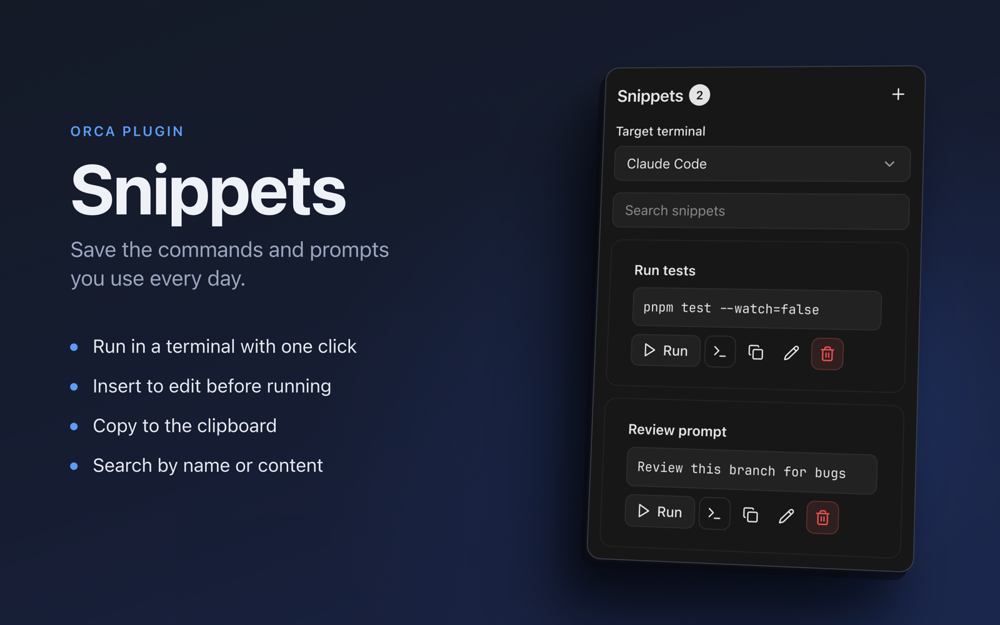
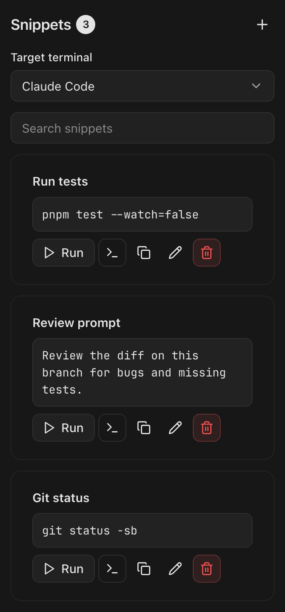

# Snippets for Orca

[](https://www.onorca.dev/plugins/chrisluo5311/orca-snippet)
[](https://github.com/chrisluo5311/orca-snippet/tags)
[](LICENSE)



Save the commands and prompts you use every day, then run them in a terminal, insert them for editing, or copy them, all from Orca's right sidebar.

<p align="center">
  
</p>

## Features

- **Run**: types a snippet into the target terminal and presses Enter.
- **Insert**: types it without pressing Enter, so you can adjust it first.
- **Copy**: puts it on the system clipboard.
- **Target terminal**: choose which of the workspace's terminals receives the text, such as a shell or a coding agent session. The choice is remembered per workspace.
- **Search**: filters snippets by name and content as you type.
- **Edit and delete**: change a snippet in place. Deleting asks for confirmation.
- Works with shell commands and with multi-line agent prompts.
- Snippets are stored in the plugin's own data folder and survive restarts.

## Installation

### From the plugin directory

Open **Settings → Plugins** in Orca, search for **Snippets**, and choose **Install**.

### From the Git URL

1. In Orca, open **Settings → Plugins → Add plugin → From a Git URL…**
2. Paste `https://github.com/chrisluo5311/orca-snippet#v0.1.2` and choose **Install**.
3. Review the requested access and enable the plugin.

The panel then appears in the right sidebar.

## Usage

1. Open the **Snippets** panel in the right sidebar.
2. Press **+**, give the snippet a name and content, then press **Save** (or Ctrl+Enter in the content box).
3. Choose a **Target terminal**, then press **Run**, **Insert** (terminal icon) or **Copy** on any snippet.

## Permissions

Orca asks you to approve these before the plugin runs:

| Access | Why |
| --- | --- |
| `trusted-worker` | Sandboxed panels cannot type into a terminal or reach the clipboard, so a small worker process does both on the panel's behalf. |
| `workspace:read` | Lists the terminals in the focused workspace for the **Target terminal** menu. |
| `terminal:send` | Types the snippet into the terminal you chose. |

The plugin makes no network requests. Text is sent only when you press **Run** or **Insert**.

Copying uses the operating system's clipboard tool: `Set-Clipboard` on Windows, `pbcopy` on macOS, and `wl-copy`, `xclip` or `xsel` on Linux (one of these must be installed).

## Requirements

Orca 1.4.247 or later (desktop app).

## Development

```sh
git clone https://github.com/chrisluo5311/orca-snippet.git
cd orca-snippet
orca plugin dev watch .     # load into Orca and reload on save
```

| Command | Purpose |
| --- | --- |
| `orca plugin test .` | Run the panel and worker unit tests in Node |
| `orca plugin check .` | Render every scenario in `src/panel.check.ts` |
| `orca plugin validate .` | Run the same manifest checks as the plugin directory |

### Project layout

```
orca-plugin.json      Plugin manifest
src/panel.tsx         Sidebar panel (Orca components, no build step)
src/worker.ts         Worker: sends text to terminals and writes the clipboard
src/protocol.ts       Typed requests shared by the panel and the worker
src/*.test.ts(x)      Unit tests
src/panel.check.ts    Render scenarios for `orca plugin check`
```

## Contributing

Issues and pull requests are welcome. Please run `orca plugin test .` and `orca plugin validate .` before opening a pull request.

## License

[MIT](LICENSE)
